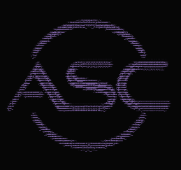

<div align="center">



<h1>
  
</h1>

<b>Sriramachandra Anumanchipalli</b> &nbsp;·&nbsp; <code>@ascsrirama</code><br/>
Computer Systems Engineering @ University of Auckland

<a href="https://ascsrirama.com"></a>


</div>

---

### `[ BIOGRAPHY ]`

Computer Systems Eng student @ UoA. Into embedded systems, firmware, robotics & web dev.
I like projects where hardware and software meet: custom PCBs, microcontrollers, and the tooling around them.

---

### `[ CURRENTLY ]`

```text
> status  : building
> focus   : firmware / hardware / pcb
> now     : web flight tracker + ASC_F1N4NC3
```

---

### `[ FEATURED PROJECTS ]`

| Project | What it is | Stack |
|---|---|---|
| 💰 **ASC_F1N4NC3** | Personal budget planner: payday-anchored budgets, spending forecasts and trend insights, glassmorphism UI with rotating dial navigation. *(in progress: income planner, bank CSV import, anomaly detection)* | `SvelteKit` `TypeScript` `Firebase` `Netlify` |
| 🔑 **ASC_K3YCH41N** | PCB keychain / business card | `Altium` |
| 🌍 **Flight Tracker** | Web-based flight tracker *(in progress)* | `JavaScript` `WebGL` |

> Repos are going public soon. Watch this space.

<!--
When the repos are public, swap the table for live pin cards:

<a href="https://github.com/ascsrirama/REPO-NAME">
  
</a>
-->

---

### `[ TECHNOLOGIES & SKILLS ]`

**Languages**

<table>
<tr>
<td align="center" width="80"><br/><sub>C</sub></td>
<td align="center" width="80"><br/><sub>C++</sub></td>
<td align="center" width="80"><br/><sub>C#</sub></td>
<td align="center" width="80"><br/><sub>Python</sub></td>
<td align="center" width="80"><br/><sub>Java</sub></td>
<td align="center" width="80"><br/><sub>TypeScript</sub></td>
<td align="center" width="80"><br/><sub>JavaScript</sub></td>
<td align="center" width="80"><br/><sub>HTML</sub></td>
<td align="center" width="80"><br/><sub>Bash</sub></td>
<td align="center" width="80"><br/><sub>MATLAB</sub></td>
</tr>
</table>

**Hardware & embedded**

<table>
<tr>
<td align="center" width="80"><br/><sub>STM32</sub></td>
<td align="center" width="80"><br/><sub>MSP430</sub></td>
<td align="center" width="80"><br/><sub>ESP32</sub></td>
<td align="center" width="80"><br/><sub>Pico</sub></td>
<td align="center" width="80"><br/><sub>Altium</sub></td>
<td align="center" width="80"><br/><sub>PlatformIO</sub></td>
<td align="center" width="80"><br/><sub>Quartus</sub></td>
<td align="center" width="80"><br/><sub>ATmega328P</sub></td>
<td align="center" width="80"><br/><sub>LTspice</sub></td>
<td align="center" width="80"></td>
</tr>
</table>

**Web & tooling**

<table>
<tr>
<td align="center" width="80"><br/><sub>SvelteKit</sub></td>
<td align="center" width="80"><br/><sub>Supabase</sub></td>
<td align="center" width="80"><br/><sub>Firebase</sub></td>
<td align="center" width="80"><br/><sub>Spring Boot</sub></td>
<td align="center" width="80"><br/><sub>Three.js</sub></td>
<td align="center" width="80"><br/><sub>Cloudflare</sub></td>
<td align="center" width="80"><br/><sub>Netlify</sub></td>
<td align="center" width="80"><br/><sub>Linux</sub></td>
<td align="center" width="80"><br/><sub>GitHub</sub></td>
</tr>
</table>

---

### `[ SOCIAL MEDIA ]`

<a href="https://github.com/ascsrirama"></a>
<a href="https://www.linkedin.com/in/ascsrirama"></a>
<a href="https://ascsrirama.com"></a>