


<a href="https://ascsrirama.com"></a>

 

<picture><source media="(prefers-color-scheme: light)" srcset="assets/ui/h-biography-light.svg" /></picture>

Computer Systems Eng student @ UoA. Into embedded systems, firmware, robotics & web dev. 

 

<picture><source media="(prefers-color-scheme: light)" srcset="assets/ui/h-currently-light.svg" /></picture>

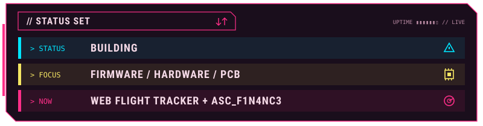

 

<picture><source media="(prefers-color-scheme: light)" srcset="assets/ui/h-projects-light.svg" /></picture>

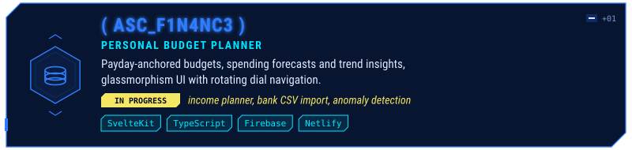
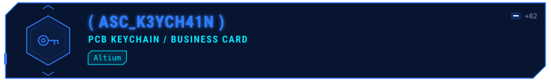
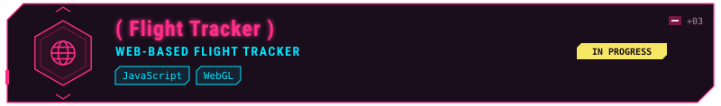

<i>&gt; Repos are going public soon. Watch this space.</i>

<!--
When the repos are public, swap the project cards for live pin cards:

-->

 

<picture><source media="(prefers-color-scheme: light)" srcset="assets/ui/h-skills-light.svg" /></picture>

<picture><source media="(prefers-color-scheme: light)" srcset="assets/ui/s-languages-light.svg" /></picture>

<table align="center">
<tr>
<td align="center" width="80"> C</td>
<td align="center" width="80"> C++</td>
<td align="center" width="80"> C#</td>
<td align="center" width="80"> Python</td>
<td align="center" width="80"> Java</td>
<td align="center" width="80"> TypeScript</td>
<td align="center" width="80"> JavaScript</td>
<td align="center" width="80"> HTML</td>
<td align="center" width="80"> Bash</td>
<td align="center" width="80"> MATLAB</td>
</tr>
</table>

<picture><source media="(prefers-color-scheme: light)" srcset="assets/ui/s-hardware-light.svg" /></picture>

<table align="center">
<tr>
<td align="center" width="80"> STM32</td>
<td align="center" width="80"> MSP430</td>
<td align="center" width="80"> ESP32</td>
<td align="center" width="80"> Pico</td>
<td align="center" width="80"> Altium</td>
<td align="center" width="80"> PlatformIO</td>
<td align="center" width="80"> Quartus</td>
<td align="center" width="80"> ATmega328P</td>
<td align="center" width="80"> LTspice</td>
<td align="center" width="80"></td>
</tr>
</table>

<picture><source media="(prefers-color-scheme: light)" srcset="assets/ui/s-web-light.svg" /></picture>

<table align="center">
<tr>
<td align="center" width="80"> SvelteKit</td>
<td align="center" width="80"> Supabase</td>
<td align="center" width="80"> Firebase</td>
<td align="center" width="80"> Spring Boot</td>
<td align="center" width="80"> Three.js</td>
<td align="center" width="80"> Cloudflare</td>
<td align="center" width="80"> Netlify</td>
<td align="center" width="80"> Linux</td>
<td align="center" width="80"> GitHub</td>
</tr>
</table>

 

<picture><source media="(prefers-color-scheme: light)" srcset="assets/ui/h-social-light.svg" /></picture>

<a href="https://github.com/ascsrirama">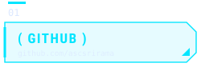</a>
<a href="https://www.linkedin.com/in/ascsrirama">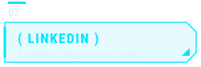</a>
<a href="https://ascsrirama.com">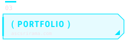</a>

